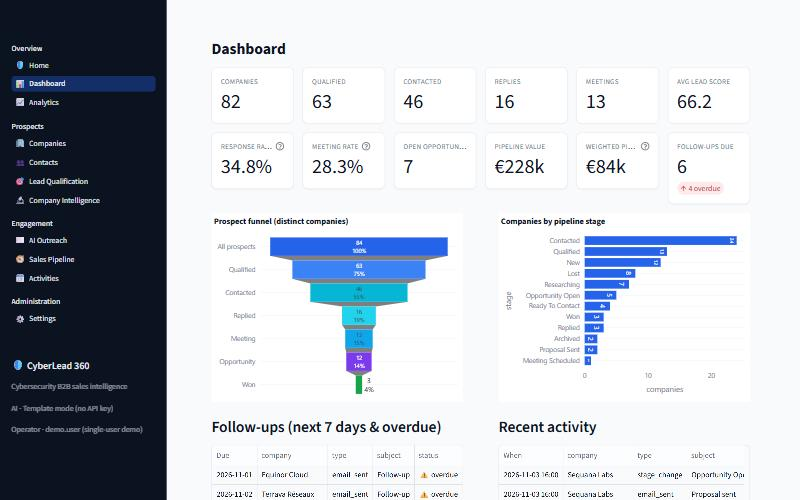
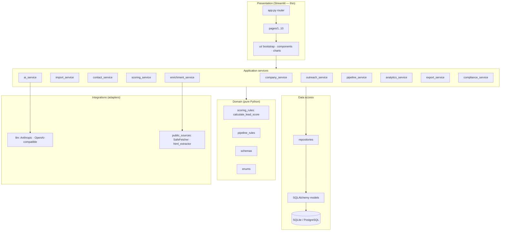
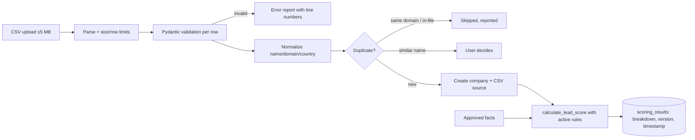
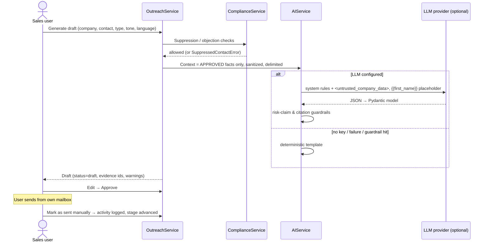
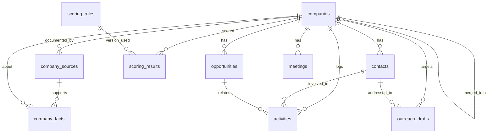
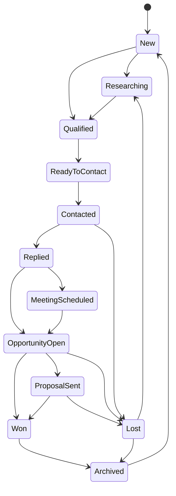
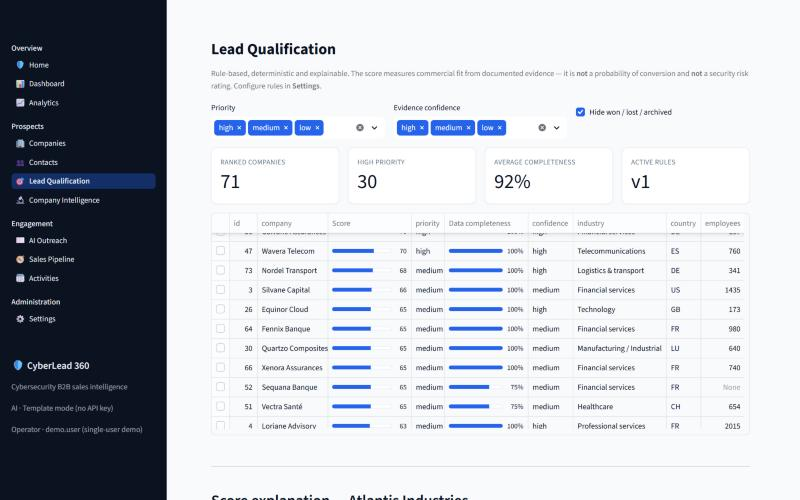
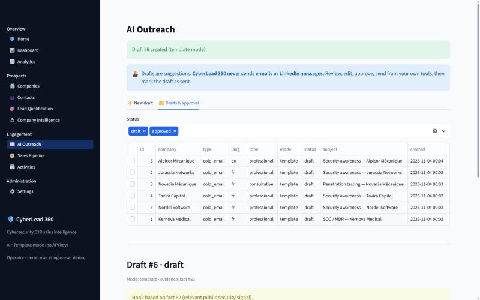
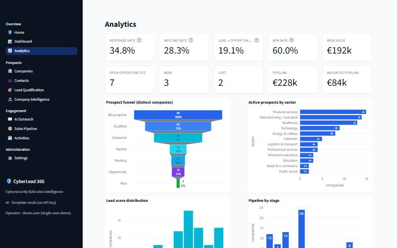

# 🛡️ CyberLead 360

**AI-Powered Cybersecurity B2B Sales Intelligence & Prospect Management Platform**

CyberLead 360 helps cybersecurity service providers (MSSPs, audit and pentest firms,
consultancies) find, qualify and engage B2B prospects with traceable evidence. It combines
an explainable lead-scoring engine, sourced company intelligence, AI-assisted outreach that
a human must approve, a CRM pipeline and conversion analytics. It is a Python/Streamlit
modular monolith.

> **Status:** working, tested **demonstrator**. It is not production-ready as-is: there is no
> authentication, it is single-operator, and it is meant for local use. See [Limitations](#16-limitations).



---

## Table of contents
1. [Introduction](#1-introduction) · 2. [Business problem](#2-business-problem) · 3. [Solution](#3-proposed-solution) ·
4. [Features](#4-key-features) · 5. [Stack](#5-technology-stack) · 6. [Architecture](#6-architecture) ·
7. [Data flow](#7-data-flow) · 8. [Entity relationships](#8-database-entity-relationships) ·
9. [Installation](#9-installation) · 10. [Configuration](#10-configuration) · 11. [Demo data](#11-demo-data) ·
12. [Usage](#12-usage-examples) · 13. [Scoring](#13-scoring-explanation) · 14. [AI architecture](#14-ai-architecture) ·
15. [Security](#15-security-considerations) · 16. [Limitations](#16-limitations) · 17. [Testing](#17-testing) ·
18. [Docker](#18-docker-deployment) · 19. [Screenshots](#19-screenshots) · 20. [Roadmap](#20-roadmap)

Further documentation: [Architecture](docs/ARCHITECTURE.md) · [Database](docs/DATABASE.md) ·
[Scoring](docs/SCORING.md) · [AI design](docs/AI_DESIGN.md) · [Security](docs/SECURITY.md) ·
[GDPR](docs/GDPR.md) · [User guide](docs/USER_GUIDE.md) · [Deployment](docs/DEPLOYMENT.md) ·
[Learning guide](docs/LEARNING_GUIDE.md) · [Interview guide](docs/INTERVIEW_GUIDE.md) ·
[Verification report](docs/VERIFICATION.md)

---

## 1. Introduction
CyberLead 360 brings company research, qualification and engagement into one auditable
workflow. Every fact has a source, every score has an explanation, and every message draft
needs a human decision.

## 2. Business problem
Cybersecurity providers prospecting B2B accounts tend to run into the same problems:
* Research lives in spreadsheets, without sources or dates, so nobody can tell later *why* an account was prioritized.
* Lead scores are opaque, or worse, they imply a target is "vulnerable" because of its sector. That is inaccurate and commercially damaging.
* Generic AI-written outreach invents facts and creates compliance risk (GDPR, unsolicited messaging).
* Conversion metrics are computed inconsistently, for example by counting e-mails instead of companies.

## 3. Proposed solution
A single application that:
1. Imports and **deduplicates** target companies with validation.
2. Stores **public facts with their sources**, freshness and human review status.
3. Computes a **transparent, versioned, rule-based lead score** that separates *missing data* from *negative evidence*.
4. Generates **evidence-grounded outreach drafts** with an LLM (optional) or deterministic templates. A human approves each one, and the app **never sends anything**.
5. Manages contacts, a **12-stage pipeline**, opportunities, activities and meetings.
6. Reports KPIs with **documented denominators**, counted per distinct company.
7. Builds in **privacy controls**: suppression list, objections, anonymization, retention, access export and an audit log.

## 4. Key features
| Module | Implemented capabilities |
|---|---|
| Companies | Create / edit / archive / restore, search & filters (sector, country, size, score, stage), priority sort, CSV import with preview and per-row error report, duplicate detection (domain + fuzzy name), explicit audited merge, CSV export |
| Contacts | Company-linked contacts, search/filter, rectification, status, objection → suppression, anonymize / delete, JSON access export, restricted-by-default export |
| Lead qualification | Explainable 100-point score, criterion breakdown with evidence ids, completeness and confidence shown separately, history, rule versions, controlled recalculation, impact preview |
| Company intelligence | Sources (type, URL, dates, verification), facts (type, confidence, review), freshness indicators, review queue, optional SSRF-hardened retrieval of the company's own website |
| AI assistant | Company summary, service-alignment analysis, outreach drafts (5 message types × 5 tones × EN/FR); Anthropic or OpenAI-compatible provider, or template mode |
| Pipeline | 12 prospect stages with enforced transitions, opportunities (open → proposal → won/lost with mandatory loss reason), stage synchronization, board view |
| Activities | E-mail, call, LinkedIn, reply, note, follow-up logging; follow-up queue; meeting records (no invitations sent) |
| Analytics | 15 KPIs; funnel, sector, score distribution, stage, meetings over time, conversion by sector, monthly activity, value by stage; CSV exports |
| Settings | Scoring rule editor, AI status and budgets, retention, suppression list, audit log viewer |

## 5. Technology stack
| Concern | Choice | Why |
|---|---|---|
| Language | Python 3.12 | Data and AI ecosystem, readability |
| UI | Streamlit 1.66 | Fast data-app development; kept as a thin presentation layer |
| Data processing | Pandas 3 | Analytical transformations and KPI computation |
| ORM / migrations | SQLAlchemy 2.1 + Alembic | Typed models, parameterized queries, versioned schema |
| Database | SQLite (local) / PostgreSQL (production) | Zero setup for the demo, robust server database for production |
| Validation | Pydantic 2 + pydantic-settings | One validation gate for forms, CSV, config and LLM output |
| Charts | Plotly 7 | Interactive charts |
| HTTP / HTML | httpx + BeautifulSoup4 | Controlled retrieval and inert text extraction |
| LLM | `anthropic` SDK (Claude), `openai` SDK (OpenAI-compatible) | Official SDKs behind a provider interface |
| Quality | Pytest, Ruff, Bandit, pip-audit | Tests, lint/format, security checks |
| Packaging | uv (`uv.lock`), Docker, Docker Compose, GitHub Actions | Reproducible installs and CI |

## 6. Architecture

Pages never contain scoring rules, transactions or LLM calls. Each user action is one
`run_action(fn)` call that opens a transaction, calls a service and commits, or rolls back
and shows the error. Details: [docs/ARCHITECTURE.md](docs/ARCHITECTURE.md).

## 7. Data flow
**Import and scoring pipeline**

**AI-assisted outreach workflow**


## 8. Database entity relationships

`suppression_records` and `audit_events` are independent tables. All 12 tables, constraints
and cascade rules are described in [docs/DATABASE.md](docs/DATABASE.md).

**Prospect lifecycle**

(Simplified. The full transition table is in `domain/pipeline_rules.py`.)

## 9. Installation
Prerequisites: [uv](https://docs.astral.sh/uv/) (it installs Python 3.12 automatically) and Git.

**Windows PowerShell**
```powershell
git clone <your-fork-url> cyberlead-360
cd cyberlead-360
uv sync --all-extras                            # creates .venv and installs locked deps
Copy-Item .env.example .env                     # optional: adjust settings
uv run python scripts/initialize_database.py   # Alembic migrations + default rules
uv run python scripts/seed_demo.py              # fictional demo data
uv run python scripts/verify_setup.py           # health checks
uv run streamlit run app.py                     # http://localhost:8501
```
**Linux / macOS**
```bash
git clone <your-fork-url> cyberlead-360 && cd cyberlead-360
uv sync --all-extras
cp .env.example .env
make init seed run
```
Without uv, use `python -m venv .venv`, activate it, run `pip install -e ".[postgres]" pytest ruff`,
and then the same scripts with `python` instead of `uv run python`. See [docs/DEPLOYMENT.md](docs/DEPLOYMENT.md).

## 10. Configuration
All settings are environment variables (or `.env`), validated by `config/settings.py`.
Secrets are `SecretStr` and are never displayed or stored in the database.

| Variable | Default | Purpose |
|---|---|---|
| `DATABASE_URL` | `sqlite:///./data/cyberlead360.db` | SQLAlchemy URL (`postgresql+psycopg://…` for PostgreSQL) |
| `AUTO_MIGRATE` | `true` | Run Alembic at app start |
| `LLM_PROVIDER` | `none` | `none`, `anthropic` or `openai_compatible` |
| `ANTHROPIC_API_KEY` / `ANTHROPIC_MODEL` | — / `claude-opus-5-5` | Claude configuration |
| `OPENAI_API_KEY` / `OPENAI_BASE_URL` / `OPENAI_MODEL` | — | Any OpenAI-compatible endpoint |
| `LLM_MAX_OUTPUT_TOKENS`, `LLM_MAX_INPUT_CHARS`, `LLM_TIMEOUT_SECONDS` | 2000 / 12000 / 60 | Token, context and time budgets |
| `LLM_INPUT_PRICE_PER_MTOK`, `LLM_OUTPUT_PRICE_PER_MTOK` | 0 | Enables cost estimates |
| `ENABLE_WEB_RETRIEVAL` | `false` | Allow fetching a company's own public website |
| `MAX_UPLOAD_MB`, `MAX_IMPORT_ROWS` | 5 / 5000 | Upload limits |
| `CONTACT_RETENTION_DAYS`, `FACT_FRESHNESS_DAYS` | 730 / 365 | Privacy and freshness |

## 11. Demo data
`scripts/seed_demo.py` (or the **Load fictional demo data** button on an empty Home page)
creates 84 companies, 149 contacts, 176 sourced facts, about 400 activities, 12
opportunities and 13 meetings, all **fictional**:
* domains and e-mails use the reserved `.example` TLD, and phones use the 555-01xx range;
* every source is titled *"Fictional demo source … (not real)"*, so no real publication is cited;
* the seed is deterministic (`random.Random(42)`), and dates are relative to an anchor day (`--anchor-date`).

`data/samples/companies_sample.csv` demonstrates the import, including one duplicate row and one invalid row.

## 12. Usage examples
* **Qualify an account:** in *Company Intelligence*, record a source, add a fact and approve it. The score updates and *Lead Qualification* shows which fact moved which criterion.
* **Change targeting:** in *Settings → Scoring rules*, add a primary market, review the impact preview, then publish v2 and recalculate. The score history keeps both versions.
* **Write outreach:** in *AI Outreach*, pick a company, contact, type, tone and language and click *Generate draft*. Then edit, approve, send it from your mailbox, and *Mark as sent manually*.
* **Honour an objection:** in *Contacts → Manage → Record objection*. The e-mail hash is suppressed, and drafts, outbound activities and re-imports are blocked.

## 13. Scoring explanation
| Criterion | Max | Rule (default, configurable) |
|---|---|---|
| Industry fit | 30 | Manufacturing, healthcare, finance 30 · energy 28 · technology 25 · … · other 5 |
| Company size | 20 | Bands: 1–49 → 4 · 50–249 → 12 · 250–999 → 20 · 1000–4999 → 16 · 5000+ → 10 |
| Documented need | 35 | Explicit sourced need 35 · relevant public signal 20 · none 0 (approved facts only) |
| Geographic fit | 15 | Primary markets 15 · secondary 8 · other 0 |

Priority: high ≥ 70, medium ≥ 45. Each criterion reports `matched / partial / no_match /
no_evidence / missing`, so **"unknown" is never shown as "bad"**. Data completeness and
evidence confidence are reported **separately** from the score. The score is a
**targeting-fit indicator**: it is not a conversion probability and not a security risk
rating. Full details: [docs/SCORING.md](docs/SCORING.md).

## 14. AI architecture
* A provider interface (`LLMProvider` Protocol) with Anthropic (`messages.parse` + Pydantic structured output) and OpenAI-compatible (JSON mode + Pydantic validation) adapters.
* **Grounding:** only *approved* facts, each with an id. Unknown citations are removed.
* **Prompt-injection defence:** source text is sanitized and wrapped in `<untrusted_company_data>`, and the system rules say to ignore instructions found inside it.
* **Guardrails:** outputs that assert vulnerabilities, breaches, incidents or non-compliance are rejected, and the app falls back to the template. Service names such as "incident response readiness" are whitelisted.
* **Data minimization:** contact names, e-mails and phones are never sent. `{{first_name}}` is filled locally.
* **Budgets:** input character budget (lower-priority facts dropped first), output tokens, timeout, retries, token usage and optional cost estimate. Prompts are not logged.
* **Fallback:** a deterministic template engine (EN/FR) runs whenever no key is configured or a call fails.
Details: [docs/AI_DESIGN.md](docs/AI_DESIGN.md).

## 15. Security considerations
Parameterized ORM queries and escaped `LIKE` wildcards; Pydantic validation at every
boundary; upload size and row limits; CSV formula-injection neutralization on export;
untrusted text rendered as plain text; an SSRF-hardened fetcher (public-IP check on every
DNS answer and redirect hop, standard ports only, robots.txt, rate limit, size cap, HTML
only); secrets only in the environment; log redaction of e-mails and keys; Streamlit bound
to localhost with XSRF and CORS protection; a non-root Docker image; Bandit and pip-audit
in CI. Threat model: [docs/SECURITY.md](docs/SECURITY.md). Privacy: [docs/GDPR.md](docs/GDPR.md).

## 16. Limitations
* **No authentication or authorization.** The app is single-operator (`OPERATOR_NAME`). Do **not** expose it to a network without adding authentication (OIDC/SSO), roles and HTTPS.
* SQLite suits one user. Use PostgreSQL for concurrent use.
* Retrieval is limited to one page of the company's own site, and a residual DNS-rebinding risk is mitigated only at the application layer.
* The LLM risk-claim filter is pattern-based. It reduces risk but does not replace human review, which is why approval is mandatory.
* Template outreach quotes the stored fact verbatim, so a French draft can contain an English fact.
* The real Anthropic/OpenAI calls are covered by mocked tests only. No live API call was made during development.
* Not a legal compliance product: [GDPR.md](docs/GDPR.md) lists what the operator must still do.

## 17. Testing
```powershell
uv run pytest -q                 # 190 tests: unit + integration + UI page rendering
uv run ruff check . ; uv run ruff format --check .
```
Coverage includes scoring boundaries and determinism, missing data, rule versions,
normalization, duplicate detection and merge, CSV validation, DB constraints,
contact/company relations, stage and opportunity transitions, KPI formulas and zero
denominators, AI fallback and structured-output validation, prompt hygiene, suppression,
anonymization, retention, exports, SSRF defences (mocked HTTP), Alembic-vs-models drift,
seed determinism, and headless rendering of all 11 pages (`streamlit.testing`). The
latest results are recorded in [docs/VERIFICATION.md](docs/VERIFICATION.md).

## 18. Docker deployment
```powershell
docker compose up --build -d                                   # SQLite on a named volume
$env:POSTGRES_PASSWORD = "choose-a-strong-one"
docker compose -f docker-compose.yml -f docker-compose.postgres.yml up --build -d
```
The image runs as a non-root user, has a health check on `/_stcore/health`, and publishes
the port on `127.0.0.1` only. See [docs/DEPLOYMENT.md](docs/DEPLOYMENT.md) for a production checklist.

## 19. Screenshots
| Dashboard | Lead qualification |
|---|---|
|  |  |
| **AI outreach** | **Analytics** |
|  |  |

## 20. Roadmap
1. Authentication (OIDC) and role-based access (admin / sales / read-only), plus per-user ownership.
2. FastAPI backend exposing the same services, when other clients (CRM sync, mobile) need them.
3. Background worker (e.g. Celery + Redis) for bulk rescoring, retrieval and LLM batches, once they exceed request time.
4. Mailbox and calendar integrations with explicit, per-message user consent.
5. pgvector semantic search over facts. OpenTelemetry tracing.
6. Field-level encryption for contact data and automated retention jobs.

---
**GitHub description:** *Explainable, evidence-grounded B2B sales intelligence for cybersecurity providers — Streamlit · SQLAlchemy · Pydantic · optional LLM (Claude/OpenAI) with human-approved outreach.*

**Topics:** `cybersecurity` `b2b-sales` `sales-intelligence` `crm` `lead-scoring` `explainable-ai`
`streamlit` `sqlalchemy` `alembic` `pydantic` `pandas` `plotly` `llm` `anthropic` `gdpr` `python`

License: MIT. All demo data is fictional.
